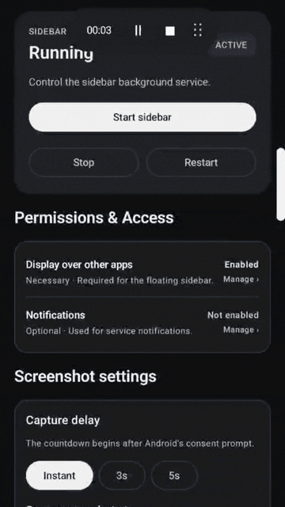
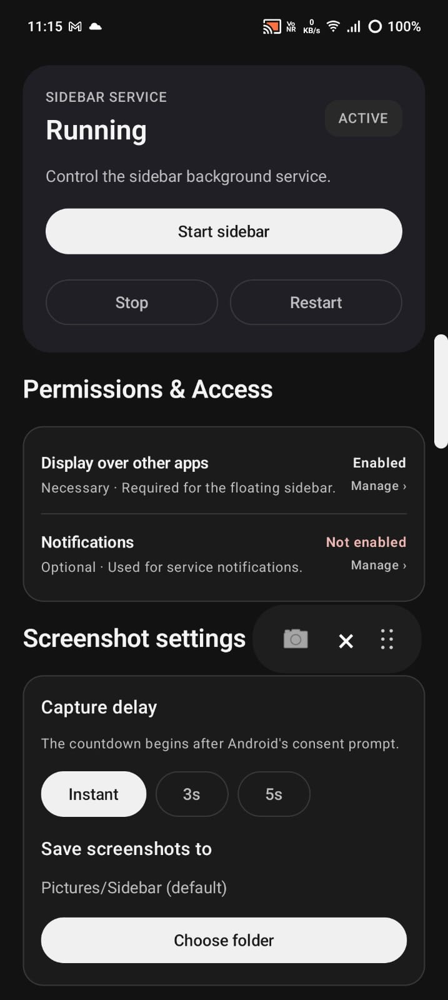
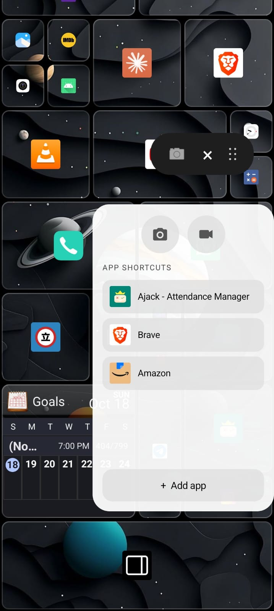
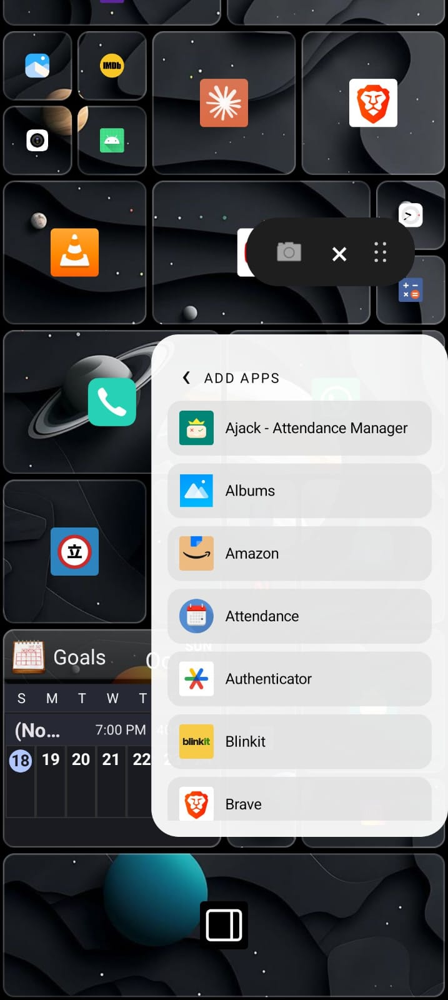
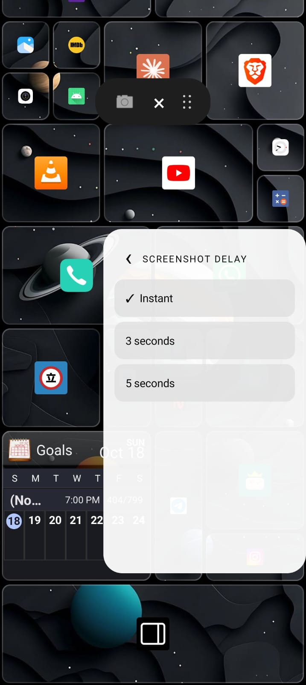

# 📱 Android Sidebar

You know when you're trying to debloat your phone one day, and you accidentally delete the sidebar and screenshot features on your phone?

No?

So it was just me. Anyway.

I wanted a sidebar that could bring those essentials back without needing root access, so I built one, a tiny floating companion for screenshots, screen recordings, and app shortcuts, because digging through your phone to find things gets old.

## 🎬 Demo

See Sidebar in action!

<p align="center">
  
</p>

## 📸 Screenshots

| Dashboard | Floating Sidebar | App Shortcuts |
|:---:|:---:|:---:|
|  |  |  |

| Screenshot Delay | Recording Audio |
|:---:|:---:|
|  |  |
## ✨ Features

- **Floating sidebar:** Your controls, always a tap away.
- **Screenshots:** Capture your screen without hunting for the screenshot button.
- **Screen recording:** Record your screen when you need to show something.
- **Audio options:** Choose from supported device audio and microphone recording options.
- **App shortcuts:** Keep your frequently used apps within reach.
- **Custom storage locations:** Decide where your screenshots and recordings go. Your files, your rules.
- **Persistent sidebar service:** Keeps the sidebar alive even after you close the app, and does its best to stay running when Android tries to kill background processes.

## 🛠️ Tech Stack

- **Language:** Kotlin
- **UI:** Jetpack Compose and Android native views
- **Platform:** Android
- **Minimum SDK:** Android 11 (API 30)
- **Build system:** Gradle with Kotlin DSL

## 📋 Requirements

- Android Studio with a compatible Android SDK and JDK.
- Android device running Android 11 or later.
- USB debugging enabled for installation through ADB, or use Android Studio's device deployment.
- Required permissions granted for the features you want to use.

🔓 Root access is not required.

## 📦 Build from Source

### 1. Clone the repository

```bash
git clone https://github.com/Im-1ucky/Sidebar.git
cd Sidebar
```

Open the project in Android Studio and allow Gradle to synchronize dependencies.

### 2. Build the Debug APK

From the project root, run:

```bash
./gradlew assembleDebug
```

The debug APK is generated at:

```text
app/build/outputs/apk/debug/app-debug.apk
```

### 3. Build the Release APK

Connect your Android device with USB debugging enabled, then run:

```bash
./gradlew assembleRelease
```

The release APK will be generated at:

```text
app/build/outputs/apk/release/app-release-unsigned.apk
```

You could venture into the abyss of Gradle builds and dependencies... or take the easy way out.
url

## 📁 Permissions and Setup

Android Sidebar relies on system permissions for features that operate outside the main activity.

| Permission or access    | Purpose                                                      |
| ----------------------- | ------------------------------------------------------------ |
| Display over other apps           | Display the floating sidebar                                 |
| Notifications (Optional)          | Show service and recording notifications where required      |
| Foreground service                | Keep the sidebar service running                             |
| Screen-capture consent            | Allow screen recording through Android's MediaProjection API |
| Microphone                        | Record external audio when requested                         |
| Storage folder access             | Save screenshots and recordings to user-selected folders     |

## ⚙️ How It Works

### Screenshot capture

The screenshot flow uses the Android-supported capture mechanism implemented by the app. Screenshot access depends on the relevant permissions and system restrictions.

### Screen recording

Screen recording uses Android's MediaProjection framework. Android requires user consent before a recording session can begin. Recording is managed separately from the sidebar service because it has its own lifecycle and foreground service requirements.

### App shortcuts

The sidebar can display selected installed applications for quick launching. Launching applications in floating windows depends on device and Android support; ordinary app launching is not equivalent to unrestricted floating-window support.

## 🛑 Important Limitations

- **Background execution:** Battery optimization and vendor-specific restrictions may stop the sidebar service.
- **Force stop:** Android generally prevents a force stopped app from restarting services until the user launches it again.
- **Audio capture:** Internal audio availability depends on Android version, device support, and the target application's audio capture policy.
- **Screenshot access:** Screenshot capture may be restricted by secure windows, protected content, or system level limitations.
